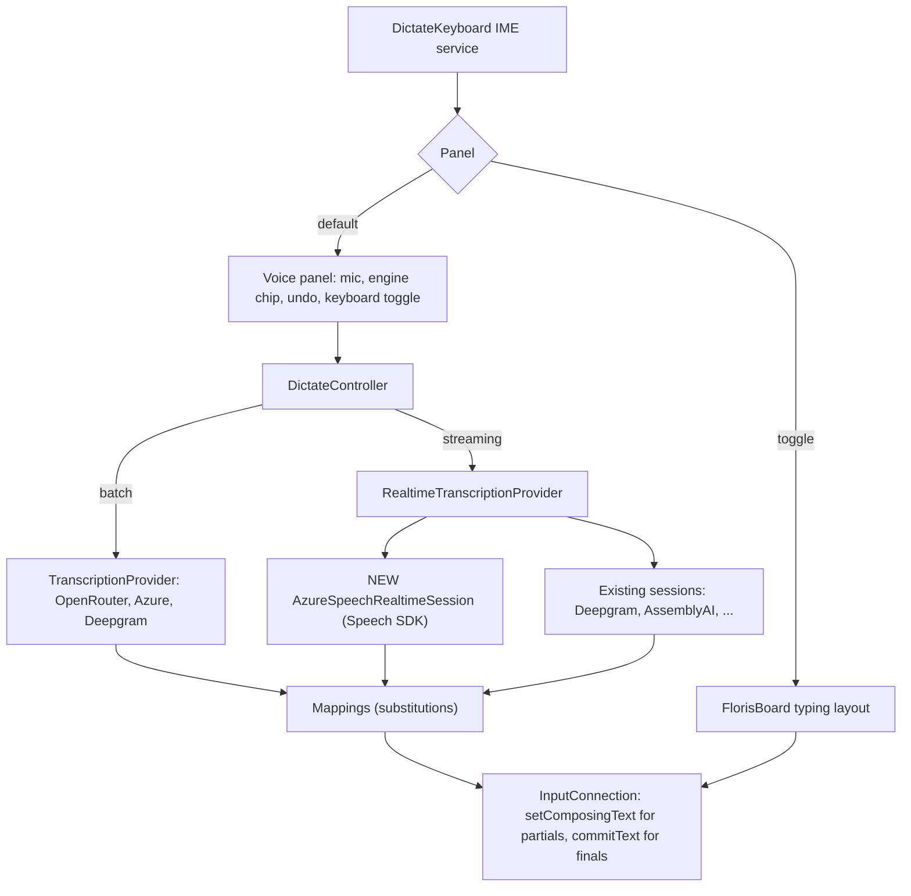

# Android voice-first keyboard: plan

Temporary planning file. When the keyboard works, move lasting rules into
`AGENTS.md` or code comments, and delete this file.

## Goal

An Android keyboard (IME) that opens in voice mode and offers:

- Batch dictation through any OpenRouter speech-to-text model, including models
  OpenRouter adds later.
- Streaming dictation through Azure MAI-Transcribe-2-Streaming, with a
  "pause to end phrase" setting (100–5000 ms).
- One tap to a full typing keyboard, to correct recognition errors.
- Keyterms (phrase list) and substitutions, as in the desktop app and Workbench.

## Facts checked on 2026-11-15

- OpenRouter speech-to-text is batch only. `POST /api/v1/audio/transcriptions`
  returns one JSON response. The docs mention no `stream` field, SSE, or
  WebSocket. The limits are 25 MB per upload and about 60 s of processing per
  request. Source: <https://openrouter.ai/docs/guides/overview/multimodal/stt>
- To list OpenRouter speech-to-text models, call
  `GET /api/v1/models?output_modalities=transcription`.
- MAI-Transcribe-2-Streaming has two ways in. Both are in public preview.
  - **Speech SDK** (what Workbench and the desktop app's
    `deepgram-stt/src/azure_stream.py` use): Speech key
    and region, `config.setModel("mai-transcribe-2-streaming")` in Java,
    SDK 1.52.0 or later. It keeps the server-side pause detection
    (`Speech_SegmentationSilenceTimeoutMs`) and `PhraseListGrammar`.
    Source: <https://learn.microsoft.com/azure/ai-services/speech-service/mai-transcribe-2-streaming-speech-sdk>
  - **Realtime WebSocket**: `wss://<resource>.services.ai.azure.com/mai/v1/realtime?intent=transcription`
    with an `api-key` header and a Foundry *deployment*. It has no server-side
    turn detection, so the client must send `input_audio_buffer.commit` at
    each pause. The docs mention no phrase list. Sessions are limited to 1 hour.
    Source: <https://learn.microsoft.com/azure/ai-services/speech-service/mai-transcribe-2-streaming-realtime>
- Workbench's model list is in
  `geneticode-dev/dotnet/src/Geneticode.Workbench.App/Services/DeepgramTranscriptionOptions.cs`
  (`OpenRouterModelChoices`).

## Recommended base: fork Dictate Keyboard

<https://github.com/DevEmperor/DictateKeyboard>: Apache-2.0, Kotlin and Jetpack
Compose. It is a fork of FlorisBoard. It was active on 2026-11-14 and is at
release 6.4.0.

It already has most of what you need:

| Need | Dictate today |
|------|---------------|
| Full typing keyboard | Yes. FlorisBoard keys, glide typing, autocorrect |
| OpenRouter batch, any model | Yes. Live catalog from `/models?output_modalities=all` |
| MAI keyterms through OpenRouter | Yes. Sends `provider.options.azure.phraseList` (`OpenAiCompatibleClient.kt`) |
| Azure MAI-Transcribe-2 batch, direct | Yes. Azure Fast Transcription preset |
| Streaming | Yes for OpenAI, Deepgram, AssemblyAI, ElevenLabs, Soniox, Gemini, Mistral, xAI |
| Azure MAI-Transcribe-2-Streaming | **No.** This is the main gap |
| Substitutions | Yes. "Mappings" find-and-replace (`DictateMappings.kt`) |
| Mic key in other keyboards | Yes. `DictateRecognitionService` |

The other candidates fit worse:

| Project | License | Why not the base |
|---------|---------|------------------|
| rustemar/voice-keyboard | MIT | Small (15k lines) and readable, but batch only. Typing layout is a beta |
| HeliBoard | GPL-3.0 | Typing keyboard only; no cloud speech-to-text |
| FlorisBoard | Apache-2.0 | Dictate already adds dictation to it |
| FUTO Keyboard | FUTO source-first, not OSI | License limits forks |
| Transcribro | ISC | On-device recognition only |
| Whisper++, whisper-to-input | GPL-3.0 | Whisper batch only, less active |

The main cost is size. Dictate is about 155k lines of Kotlin, so rebasing on
upstream needs care. Keep changes in new files where possible.

## Architecture

### New code

1. **`AzureSpeechRealtimeSession`** in
   `lib/dictate-core/.../dictate/provider/`. Add an enum value to `RealtimeApi`
   and wire it to the `AZURE` preset (`ProviderRegistry.kt`). Port the logic
   from `deepgram-stt/src/azure_stream.py`:
   - `PushAudioInputStream`, 16 kHz mono PCM16.
   - Pause timeout through `Speech_SegmentationSilenceTimeoutMs`.
   - Phrase list from Dictate's custom words.
   - `recognizing` maps to `onPartial`, and `recognized` maps to `onFinalSegment`.
   - A cancellation maps to an error.

   Dependency: `com.microsoft.cognitiveservices.speech:client-sdk` 1.52.0 or
   later. Ship only `arm64-v8a` to limit the native-library size.
2. **Azure settings**: region field, pause-to-end-phrase field. Dictate's Azure
   preset takes a resource endpoint URL today, and the SDK needs a region.
   Derive the region from the endpoint, or add a field.
3. **Voice-first default**: open on the voice panel, with a key to switch to
   typing and back. First check which Dictate settings already do this.
4. **Pinned models**: put the Workbench model list at the top of the OpenRouter
   picker. The live catalog stays below it.

### Out of scope at first

- Dictate's prepaid "cloud" credit, Wear OS module, and AI rewording. Leave
  them in place but unused, so upstream merges stay simple.
- A key proxy on jvps-2. Keys live on the phone in the first version.

## Steps

Done: the fork is <https://github.com/jerry426/DictateKeyboard>, and the
Android SDK is installed on the Mac.

1. Build the debug APK unchanged and sideload it.
2. Use it for a few days with OpenRouter, Azure batch, and Deepgram streaming.
   This shows what actually needs changing.
3. Give the app its own package name, so it never conflicts with upstream.
4. Add `AzureSpeechRealtimeSession` and its settings, then test on the phone.
5. Add the voice-first default and pinned models.
6. Consider offering the Azure streaming session upstream as a pull request,
   so the fork stays small.
